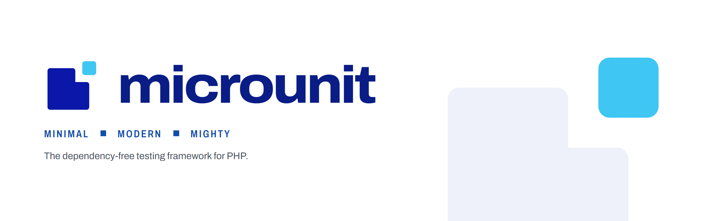
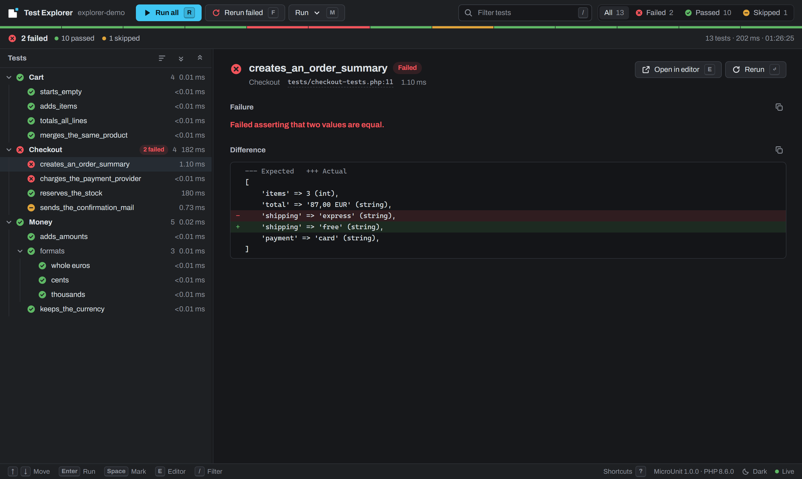

> [!IMPORTANT]
> **MicroUnit 1.0 is not released yet.** This README and the
> [documentation](https://mitarnik04.github.io/MicroUnit/) already describe 1.0, a substantial
> rewrite. Until it is out, Packagist only has the 1.0 betas, which lack much of what you read here,
> so the install command below does not work yet. Watch the repository to hear when 1.0 lands.

<p align="center">
  <picture>
    <source media="(prefers-color-scheme: dark)" srcset="assets/brand/banner-dark.png">
    
  </picture>
</p>

<p align="center">
  <strong>A new way to test PHP. Built for today.</strong><br>
  Zero dependencies, tests you can read at a glance, and runs fast enough that you never wait for them.
</p>

<p align="center">
  <a href="https://github.com/mitarnik04/MicroUnit/actions/workflows/ci.yml"></a>
  <a href="https://packagist.org/packages/microunit/microunit"></a>
  
  
  <a href="LICENSE"></a>
</p>

<p align="center">
  <a href="https://mitarnik04.github.io/MicroUnit/">Documentation</a> ·
  <a href="https://mitarnik04.github.io/MicroUnit/getting-started/">Getting started</a> ·
  <a href="https://mitarnik04.github.io/MicroUnit/migrating-from-phpunit/">Migrating from PHPUnit</a> ·
  <a href="https://mitarnik04.github.io/MicroUnit/benchmarks/">Benchmarks</a> ·
  <a href="https://mitarnik04.github.io/MicroUnit/quality-with-ai/">Quality with AI</a>
</p>

---

```php
<?php

use MicroUnit\Assertion\Assert;
use MicroUnit\Setup\TestSetup;

$tester = TestSetup::getTester('Cart');

$tester->fixture('cart', fn() => new Cart());

$tester->define('adds_items_and_totals_them', function (Cart $cart): void {
    $cart->add(new Item('Keyboard', 4900));
    $cart->add(new Item('Mouse', 1900));

    Assert::countEquals(2, $cart->items());
    Assert::exact(6800, $cart->total());
});

$tester->defineGroup('applies_discounts', function (int $percent, int $total): void {
    Assert::exact($total, new Cart(10000)->withDiscount($percent)->total());
}, [
    'none' => [0, 10000],
    'a quarter' => [25, 7500],
]);
```

```text
$ vendor/bin/microunit

-- Cart --
[✔] adds_items_and_totals_them (2.18ms)
[✔] applies_discounts_none (0.00ms)
[✔] applies_discounts_a quarter (0.00ms)

Summary: 3/3 passed, 0 failed in 14.37ms
```

No base classes, no annotations. A test is a closure with a name that says what it checks.

## Built with AI

I write MicroUnit with AI: the code, and also this README and the documentation. Docs are where AI
is at its best, because it reads the complete source and describes what is actually there.

The quality comes from what surrounds it. I design the APIs and review the code, and every change
has to pass MicroUnit's own test suite on three operating systems, static analysis, a coverage floor
and a check that no test got weaker. Before a release, the test suites of six real projects run
through it as well. [Ensuring high quality with AI](https://mitarnik04.github.io/MicroUnit/quality-with-ai/)
walks through every step and links to the proof.

## Why MicroUnit

- **Fast where it counts.** Startup and the cost of each test are kept small, which matters most
  when you re-run a single file: what you and your AI agent do all day. Measured on the real test
  suites of six popular PHP projects, with the method, raw data and every exclusion published:
  [benchmarks](https://mitarnik04.github.io/MicroUnit/benchmarks/).
- **Zero dependencies.** Not one Composer package, not even for development. Nothing to conflict
  with, nothing to audit, nothing that breaks when you upgrade something else.
- **Ready for AI coding agents.** Agents get compact JSON with only the failures (a fraction of the
  tokens), and MicroUnit warns when tests were weakened to make them pass.
  [More](https://mitarnik04.github.io/MicroUnit/ai-agents/)
- **Everything in the box.** Mocks, snapshots, data sets, fixtures, code coverage without Xdebug or
  PCOV, parallel runs, a browser Test Explorer, JUnit/HTML/log reports, and Laravel, Symfony and
  CodeIgniter integrations.
- **Works without setup, configurable in plain PHP.** Install MicroUnit, write a test and run it. No
  config file needed. When your project needs a specific setup, there are lots of options: test
  groups, parallel runs, coverage reports, output formats, the Test Explorer, framework integration
  and more. They all go in one PHP file, `microunit.config.php`, so your editor autocompletes them.
- **Easy to bring your tests along.** If MicroUnit suits your project, `microunit migrate` translates
  your PHPUnit suite, mocks and data providers included, and tells you exactly what it could not.

## Install

```bash
composer require --dev microunit/microunit
vendor/bin/microunit
```

That is all if your tests live in `tests/` and their file names end in `-tests.php`.
`vendor/bin/microunit init` writes a config and a first test, set up for Laravel, Symfony or
CodeIgniter if your project uses one. Requires PHP 8.5 or newer; tested on 8.5 and 8.6.

Coming from PHPUnit? `vendor/bin/microunit migrate` converts your tests into `tests-microunit/` and
leaves the originals alone, so both suites run side by side until you are happy.
[Migration guide](https://mitarnik04.github.io/MicroUnit/migrating-from-phpunit/)

## A quick tour

**Assertions that read like sentences.** Expected value first, actual value second, as in PHPUnit.
Plus the ones you keep writing by hand:

```php
Assert::containsSubset(['user' => ['name' => 'Ada']], $response->json());  // partial match
Assert::equivalent([3, 1, 2], $ids);                                         // any order
Assert::each($orders, fn(Order $order) => Assert::isTrue($order->isPaid()));
Assert::eventually(fn() => Assert::notNull($mailbox->latest()), timeoutInSeconds: 3);
Assert::multiple(function () use ($user) {                                   // report every failure
    Assert::exact('Ada', $user->name);
    Assert::exact('ada@example.com', $user->email);
});
Assert::matchesSnapshot($invoice->render());
```

[All assertions](https://mitarnik04.github.io/MicroUnit/assertions/) ·
[Snapshots](https://mitarnik04.github.io/MicroUnit/snapshots/)

**Mocks without a second library.**

```php
$mailer = MockBuilder::create(Mailer::class)->returns('send', true)->build()->newInstance();

new Checkout($mailer)->complete($order);

AssertMock::begin($mailer)->isCalledOnce('send')->isCalledWith('send', [$order->email]);
```

[Mocking](https://mitarnik04.github.io/MicroUnit/mocking/)

**Your framework, unchanged.**

```php
$tester->define('customers_can_place_orders', function (): void {
    Laravel::actingAs(User::factory()->create())
        ->postJson('/api/orders', ['sku' => 'KB-01'])
        ->assertCreated();

    Laravel::assertDatabaseHas('orders', ['sku' => 'KB-01']);
});
```

[Laravel, Symfony, CodeIgniter](https://mitarnik04.github.io/MicroUnit/frameworks/)

**A Test Explorer in your browser.** `microunit explorer` opens a live view of your suite: run one
test, a suite, only the failures, jump to the line in your editor. Opt-in, so it costs nothing
when you don't use it.

<p align="center">
  
</p>

[Test Explorer](https://mitarnik04.github.io/MicroUnit/test-explorer/)

**And the rest:** [parallel runs](https://mitarnik04.github.io/MicroUnit/parallel/) with
`--parallel`, [code coverage](https://mitarnik04.github.io/MicroUnit/coverage/) in pure PHP,
[integration testing](https://mitarnik04.github.io/MicroUnit/integration-testing/) with a database,
HTTP server and HTTP client in the toolkit, [reports](https://mitarnik04.github.io/MicroUnit/output/)
for JUnit, HTML, GitHub Actions and logs, and a [CLI](https://mitarnik04.github.io/MicroUnit/cli/)
where `microunit help <command>` explains everything.

## Working with AI coding agents

AI agents run tests constantly, often after every small change. Three things help in that loop:

- **Speed.** Less waiting per run adds up across hundreds of runs a day.
- **Token-cheap output.** In an agent session (Claude Code is detected automatically, others set
  `MICROUNIT_AGENT=1`) the output is one compact JSON object with only the failures: where, expected,
  actual, the code around it.
- **Protection against test cheating.** Agents sometimes "fix" a red test by deleting an assertion or
  changing the expected value. Turn on the integrity check and MicroUnit compares the tests with the last
  commit after every run, and tells the agent, and you, when a test got weaker. `microunit integrity origin/main` does the same in code review.

`vendor/bin/microunit init --skill` installs a skill that teaches your agent how to write MicroUnit
tests. [More](https://mitarnik04.github.io/MicroUnit/ai-agents/)

## The story

I started MicroUnit as a side project in May 2025, because I wanted PHP tests that were quick to
write and quick to read. It got to a public beta that summer, and then it stalled: building coverage, parallel
runs, framework integrations and a proper explorer next to a day job was more than one person could
do. AI changed that. With it as my tool, I finally had the capacity to bring MicroUnit to its first
official release and to build every feature I had imagined for it.

## Contributing

Issues, ideas and pull requests are very welcome. [CONTRIBUTING.md](CONTRIBUTING.md) explains the
setup (five minutes), the code standards and what makes a pull request easy to merge.
Security issues: please follow [SECURITY.md](SECURITY.md).

## Support the project

If MicroUnit saves you time, consider sponsoring it. It keeps the project independent and moving.

[](https://github.com/sponsors/mitarnik04)
[](https://coff.ee/mitarnikolic)

Every sponsor is listed on the [documentation site](https://mitarnik04.github.io/MicroUnit/).

## License

Apache 2.0, see [LICENSE](LICENSE).

<p align="center"><strong>Minimal. Modern. Mighty.</strong></p>
